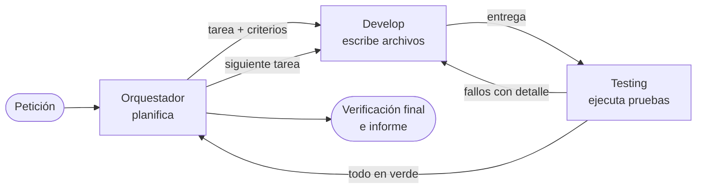

# SYNERG0S — equipo de 3 agentes de IA

Tres agentes de IA que se reparten una petición sobre una web y trabajan hasta que todas las pruebas pasan:

1. **Orquestador** — recibe la petición («añade una página de contacto a esta web»), la divide en tareas con criterios de aceptación y decide a quién le toca cada una.
2. **Develop** — implementa cada tarea escribiendo los archivos de la web.
3. **Testing** — escribe y ejecuta las pruebas de cada tarea y devuelve a Develop lo que falla, hasta que todo pasa.

En pantalla se ve en directo qué hace cada agente, en qué columna del tablero está cada tarea, la bitácora completa y la web resultante.

- **App:** https://synerg0s.vercel.app
- **Stack:** Next.js 16 (App Router) · TypeScript · Tailwind 4 · Postgres en Neon (plan gratuito) con Drizzle · AI SDK · Vercel (plan Hobby)

## Cómo funciona



«Esta web» es un sitio estático de ejemplo (un taller de cerámica: `index.html` + `styles.css`). Cada petición recibe su propia copia en la base de datos y los agentes trabajan sobre ella. El resultado se puede ver en un iframe y leer archivo a archivo.

### El bucle Develop ⇄ Testing

Estados de una tarea: `pending → developing → testing → (fixing → testing)* → passed | failed`.

Lo importante es que **Testing no opina: ejecuta**. Cada ronda de pruebas tiene tres partes y solo la primera y la última usan IA:

| Parte | Quién | Qué hace |
| --- | --- | --- |
| Tests de aceptación | IA (una vez por tarea) | Lee el código de Develop y los criterios del Orquestador y escribe tests como datos: `{ type: "exists", file: "contacto.html", selector: "form input[type=email][required]" }` |
| Ejecución | Código determinista ([`harness.ts`](src/lib/agents/harness.ts)) | Ejecuta esos tests con un parser de HTML real, más una **suite base** (enlaces que resuelven, ids únicos, `label` en cada campo, `alt`, un solo `h1`, páginas alcanzables desde el inicio, JS que compila…) y la **regresión** de las tareas ya aprobadas |
| Revisión de código | IA (solo con todo en verde) | Busca lo que un selector no ve: lógica JS rota, criterios que en realidad no se cumplen |

Si algo falla, la tarea vuelve a Develop con el detalle exacto («se esperaba al menos un elemento `nav a[href="contacto.html"]` en index.html y no hay ninguno»). Tras 4 entregas fallidas la tarea se marca como fallida y el Orquestador sigue con las demás. La revisión de código solo puede bloquear en las dos primeras entregas, para que el bucle siempre termine.

### El motor: una máquina de estados en Postgres

Vercel no ejecuta procesos largos, así que el equipo no es un bucle en memoria. [`engine.ts`](src/lib/agents/engine.ts) expone `advance(runId)`, que ejecuta **un turno de un agente** y lo guarda:

- Un cerrojo atómico (`UPDATE … WHERE lock_until < now() RETURNING`) garantiza que solo una invocación avanza cada ejecución, aunque haya varias pestañas abiertas.
- Cada turno es idempotente: el estado solo cambia al final. Si la función muere a medias, el siguiente intento repite el turno.
- El navegador llama a `POST /api/runs/:id/step` en bucle y sondea `GET /api/runs/:id?after=<últimoEvento>` cada 1,2 s. Si cierras la pestaña, al volver a abrirla la ejecución continúa donde estaba.
- Los planes gratuitos de IA fallan a ratos: cuota agotada (429) o modelo saturado (503). `LLM_MODEL` admite una cadena de modelos (principal y reservas) y, si ninguno responde, la ejecución se pausa con espera creciente y se reanuda sola; en pantalla el agente pasa a «Esperando a la IA». Tras 30 esperas seguidas se detiene y ofrece reintentar. Opcionalmente, `LLM_FALLBACK_*` añade un segundo proveedor.

### Modelo de datos

| Tabla | Contenido |
| --- | --- |
| `users` | Usuario de prueba (contraseña con bcrypt) |
| `runs` | Petición, estado, agente activo, cerrojo, consumo de IA, informe final |
| `tasks` | Tareas del plan: criterios, estado, intentos, tests escritos por Testing y último informe |
| `events` | Bitácora: todo lo que dice y hace cada agente |
| `files` | Espacio de trabajo: los archivos de la web de cada ejecución |

## Estructura

```
src/
  lib/agents/
    roles.ts      Los 3 agentes: prompt de sistema + contrato de salida (Zod)
    engine.ts     Máquina de estados que pasa el trabajo de uno a otro
    harness.ts    Banco de pruebas determinista (suite base + tests de aceptación)
  lib/llm.ts      Proveedor de IA configurable por entorno
  lib/runs.ts     Consultas y creación de ejecuciones
  db/schema.ts    Esquema Drizzle
  app/api/        login, runs, step, files, retry
  app/preview/    Sirve la web generada (en sandbox)
  components/     Tablero, tarjetas de agentes, bitácora, vista previa
tests/            Tests del banco de pruebas (node:test)
```

## Ejecutarlo en local

```bash
npm install
cp .env.example .env.local   # y rellena los valores
npm run db:push              # crea las tablas en Neon
npm run db:seed              # crea el usuario de prueba
npm run dev
```

Otros comandos: `npm test` (banco de pruebas), `npm run typecheck`, `npm run build`.

### Variables de entorno

Ninguna clave está en el repositorio: viven en `.env.local` (ignorado por git) y en las variables de entorno de Vercel. Ver [`.env.example`](.env.example).

| Variable | Para qué |
| --- | --- |
| `DATABASE_URL` | Postgres de Neon. En Vercel la inyecta la integración del Marketplace |
| `AUTH_SECRET` | Firma de la cookie de sesión (JWT HS256, `httpOnly`) |
| `DEMO_USER`, `DEMO_PASSWORD` | Usuario de prueba que crea `npm run db:seed` |
| `LLM_API_KEY`, `LLM_BASE_URL`, `LLM_MODEL` | Cualquier API compatible con OpenAI con plan gratuito (Gemini, Groq, Mistral…). `LLM_MODEL` puede ser una lista separada por comas, cada modelo con su esfuerzo de razonamiento opcional (`modelo@none`) |

## Todo en planes gratuitos

- **Vercel Hobby** para la app.
- **Neon Free** para Postgres.
- **IA:** plan gratuito de Gemini (Google AI Studio, sin tarjeta). El primer intento fue Vercel AI Gateway, pero exige una tarjeta para liberar el crédito gratuito, así que la app habla con cualquier API compatible con OpenAI y el proveedor se elige por entorno con `LLM_*`.
- **Lo que da de sí la cuota gratuita:** los modelos Flash admiten 20 peticiones al día cada uno y los Flash-Lite, más, pero en horas punta responden 503. Una petición al equipo son entre 10 y 15 llamadas, así que la app encadena varios modelos (`LLM_MODEL=modelo@nivel,…`) y pasa al siguiente cuando uno está sin cuota o saturado. Si la demo muestra «Esperando a la IA», es esto: sigue sola en cuanto algún modelo responde.
- Para proteger esa cuota: acceso con usuario de prueba y un tope diario de peticiones (`MAX_RUNS_PER_DAY`).

## Seguridad

- El código que escribe la IA se trata como **no fiable**: la vista previa se sirve con `Content-Security-Policy: sandbox` y dentro de un iframe `sandbox` sin `allow-same-origin`, así que no puede leer la cookie de sesión ni llamar a la API de la app.
- El JavaScript generado nunca se ejecuta en el servidor: el banco de pruebas solo lo compila (`vm.Script`) para detectar errores de sintaxis.
- Cada ruta de la API comprueba la sesión y que la ejecución pertenece al usuario.
- Las rutas de los archivos que devuelve Develop se validan (extensiones permitidas, sin `..`, tamaño máximo).

## Límites conocidos y siguientes pasos

- Testing verifica el HTML/CSS/JS de forma estática. No abre un navegador: no prueba el comportamiento del JS en ejecución. El siguiente paso sería lanzar Playwright en un sandbox aislado.
- El navegador conduce la ejecución. Para que avance sin ninguna pestaña abierta habría que mover el bucle a una cola o a un workflow durable.
- El estado llega por sondeo, que es suficiente para turnos de varios segundos; con más volumen pasaría a SSE.
- Un solo usuario de prueba, sin registro.

## Cómo se usó Claude Code

Todo el proyecto se programó con **Claude Code** (app de escritorio) en una sola sesión, a partir del enunciado de la prueba:

1. **Enunciado → diseño.** Claude Code recibió el enunciado tal cual y propuso la arquitectura: máquina de estados persistida en vez de un bucle en memoria (por los límites de las funciones serverless), tests ejecutados por código y no «opinados» por la IA, y vista previa en sandbox.
2. **Documentación antes que memoria.** Next.js 16 y AI SDK 7 cambian APIs respecto a versiones anteriores, así que antes de escribir leyó la documentación que viene dentro de `node_modules` (`next/dist/docs`, `ai/docs`): `proxy.ts` en lugar de `middleware.ts`, `generateText` con `Output.object`, Cache Components con `<Suspense>`.
3. **Infraestructura desde la terminal.** Creó el proyecto en Vercel con la CLI, aprovisionó Neon desde el Marketplace y comprobó con una llamada real que AI Gateway pedía tarjeta antes de descartarlo.
4. **Verificación.** Typecheck, build de producción, tests unitarios del banco de pruebas y una ejecución completa en el navegador antes de dar nada por hecho.
5. **Depuración con datos, no con suposiciones.** En la primera ejecución real Develop no recibía respuesta. Claude Code midió cada modelo con peticiones cortas y largas y encontró tres causas distintas: los Flash-Lite devolvían 503 en las respuestas largas, los Flash tardaban más de 40 s por razonar y además tienen 20 peticiones al día. De ahí salieron la cadena de modelos, el razonamiento configurable por modelo y la pausa con reintento en lugar de dar la ejecución por fallida.
6. **Secretos.** Las claves se generaron y guardaron con `vercel env`, nunca en archivos versionados.

Mi papel fue dar el encargo, aceptar los pasos que requerían mi cuenta (términos de Neon, clave del proveedor de IA), revisar el resultado y decidir qué entregar.
